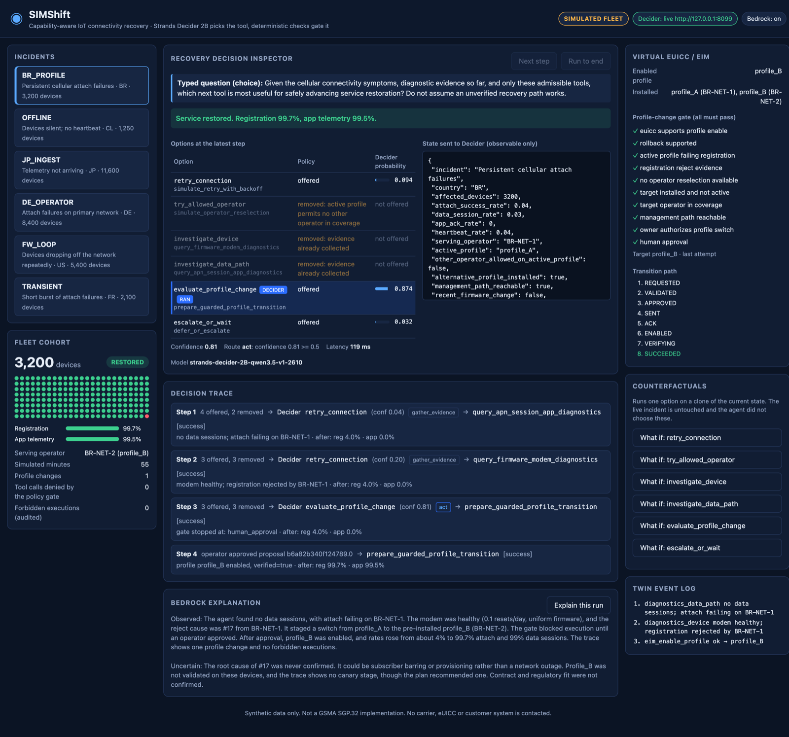
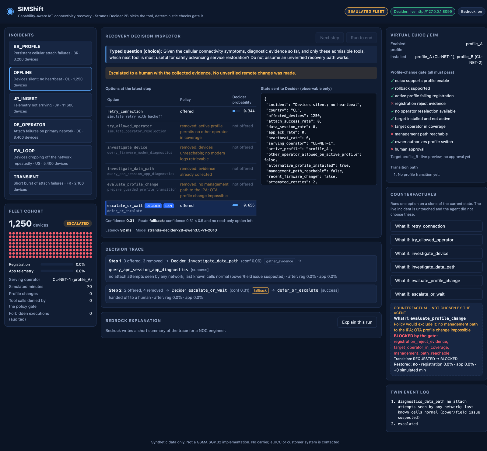

# SIMShift: When Not to Switch

**When IoT devices lose connectivity, the wrong recovery action can be worse than doing nothing.**

SIMShift is an IoT connectivity recovery agent. At every step, **Strands Decider 2B** chooses the next investigation
or recovery tool. **Strands Agents** executes exactly that tool, and **Amazon Bedrock** reviews profile-change plans,
explains outcomes, and can run the whole agent loop without ever being able to pick a tool itself. The agent works on
a deterministic digital twin of a cellular IoT fleet with virtual eSIM profiles. A hard policy decides what is
admissible, so no model can switch a profile on its own authority.

`#strands-decider-2b` `#tool-selection` · Submission for the AWS Builder Center *Agent Experience Hackathon: Strands Decider*

> **Simulation disclosure.** The fleet, operators, eSIM profiles, eIM/IPA and every number in device state are
> synthetic. No carrier, eUICC, SM-DP+ or GSMA SGP.32 operation is performed or claimed. The Decider and Bedrock
> calls are real.



## Reusable Decider decision pattern

**[`patterns/capability_aware_router/`](patterns/capability_aware_router/README.md)** is the reusable recipe:
**CapabilityAwareRouter**, a tool-selection pattern with no telecom code. Its README covers the typed question format,
the routing rule, the wiring, how to adapt it, and how to let an LLM run the loop without letting it pick the tool.
It ships with one test file per property and a non-telecom example. The core is one file,
[`router.py`](patterns/capability_aware_router/router.py).

```
state ─► policy removes inadmissible options (with reasons) ─► Decider `choice` over the rest
      ─► answer checked against the question (options, sum, argmax, derived confidence)
      ─► confidence ≥ 0.5: act │ else: most probable read-only tool │ else: fallback
         (no answer, a malformed or inconsistent answer, or an off-menu choice also goes to the fallback)
      ─► agent.tool.<selected>()  ─► same policy re-checked by a Strands InterventionHandler
```

## The decision Decider makes

SIMShift's typed question, asked at every step ([`simshift/agent.py`](simshift/agent.py)):

> *Given the cellular connectivity symptoms, diagnostic evidence so far, and only these admissible tools, which next
> tool is most useful for safely advancing service restoration? Do not assume an unverified recovery path works.*

The option set has six options, each mapped 1:1 to a registered Strands tool (descriptions in [`simshift/policy.py`](simshift/policy.py)):

| Option | Strands tool | Kind |
|---|---|---|
| `retry_connection` | `simulate_retry_with_backoff` | bounded, network-side |
| `try_allowed_operator` | `simulate_operator_reselection` | another operator **on the active profile** |
| `investigate_device` | `query_firmware_modem_diagnostics` | read-only |
| `investigate_data_path` | `query_apn_session_app_diagnostics` | read-only |
| `evaluate_profile_change` | `prepare_guarded_profile_transition` | advisory Bedrock plan review, then hard gate + human approval, then virtual eIM |
| `escalate_or_wait` | `defer_or_escalate` | fallback |

Before Decider sees the options, the policy removes inadmissible ones. A profile change is never offered:
- while another operator on the active profile is available;
- without a management path to the device;
- while the active profile registers normally;
- before modem diagnostics show a registration reject cause.

The same rules run again at the gate, together with eUICC rollback support, owner authorization and a human approval
that is bound to that exact proposal. Every attempt records its eUICC transition path (`REQUESTED → … → VERIFYING → SUCCEEDED`, or
`BLOCKED`, `ROLLED_BACK`, …). Details: [docs/architecture.md](docs/architecture.md).

## Bedrock runs the loop; Decider still picks every tool

In orchestrator mode ([`simshift/orchestrator.py`](simshift/orchestrator.py)) a Strands agent on Bedrock drives the
incident. It sees exactly two tools, `get_incident_state` and `advance_recovery`, and **neither takes an argument**.
Each `advance_recovery` call runs one policy → Decider → gated-tool step. Bedrock decides when to look, when to keep
going and how to report; it has no way to name a recovery tool, skip the gate or approve a change. Tests drive the
real Strands event loop with a scripted model to prove it ([`tests/test_orchestrator.py`](tests/test_orchestrator.py)).

## Observed runs (real Decider + Bedrock, synthetic fleet)

| Scenario | What the agent did | Outcome |
|---|---|---|
| `BR_PROFILE` | Decider leans to `retry_connection` at conf 0.04, then 0.20, so the router runs the most probable read-only diagnostics instead. Modem shows reject #17. Decider picks `evaluate_profile_change` (conf 0.81). Bedrock review recommends proceeding as a staged change (advisory; the gate does not read it), gate + approval pass, virtual eIM enables profile_B | registration **and** app telemetry restored |
| `OFFLINE` | device diagnostics and profile change excluded (no management path) → network-side check (conf 0.06, read-only) → escalate (conf 0.31, fallback) | no OTA change attempted |
| `JP_INGEST` | retry and profile change excluded (registration healthy) → Decider picks `investigate_data_path` (conf 0.71) → ingestion regression found → modem check (conf 0.09, read-only) → escalate (only option left) | no network change; root cause handed off |
| `DE_OPERATOR` | management rides on the failing cellular link, so device diagnostics and profile change are excluded → read-only check at conf 0.47 → Decider picks `try_allowed_operator` (conf 0.62) | recovered without touching the eSIM |
| `FW_LOOP` | modem diagnostics (conf 0.39, read-only) find a reset loop after a firmware rollout → retries and profile change excluded → data-path check → escalate | handed to the device team; no network or eSIM change |
| `TRANSIENT` | Decider picks `retry_connection` (conf 0.79) | restored by one bounded retry |

Single runs on 2026-10-18 and 2026-10-19. Traces: [docs/sample-runs/orchestrated/](docs/sample-runs/orchestrated/) (Bedrock-orchestrated,
all six scenarios) and [docs/sample-runs/](docs/sample-runs/) (the first Python-loop runs of the four original
scenarios, kept as recorded; they use the earlier trace format and still replay and validate in CI).
Per-step numbers, latencies and the known Decider misses: [docs/measurements.md](docs/measurements.md).

## Benchmark: Decider vs Bedrock-only vs rules vs random

60 generated incidents across the six families, every chooser running through the same router, policy and gate
([full table and raw records](docs/benchmark/benchmark-2026-10-19.md)). An escalation only counts as correct if the
diagnostic that finds the cause ran first.

| | rules | random | **Decider** | Bedrock | Bedrock + stated confidence |
|---|---:|---:|---:|---:|---:|
| Correct end state, with the evidence | 95.0% | 51.7% | **96.7%** | 91.7% | 88.3% |
| First action acceptable | 95.0% | 46.7% | **86.7%** | 81.7% | 83.3% |
| Chooser latency p50 | — | — | **94 ms** | 2,026 ms | 2,051 ms |
| Bedrock tokens | 0 | 0 | **0** | 74,673 | 81,970 |
| Forbidden executions (audited) | 0 | 0 | 0 | 0 | 0 |

Decider's raw first pick was the preferred tool only half the time; the confidence routing turned its uncertain picks
into read-only evidence gathering. Bedrock picked better first tools (81.7%), but its stated confidence never dropped
below 0.60, so the same routing never held it back. **These are synthetic incidents from families we designed**,
Decider ran on a laptop GPU and Bedrock in eu-central-1, and each chooser ran once. Read the caveats in
[docs/measurements.md](docs/measurements.md#benchmark) before quoting any of it.

## Run it

```bash
git clone https://github.com/HDGoldi/simshift-agent && cd simshift-agent
make install                     # or: uv venv && uv pip install -e . pytest
make test                        # 93 tests + trace validation; no Decider server or AWS needed
make ui                          # Recovery Decision Inspector on recorded real Decider answers: http://127.0.0.1:8090
make replay                      # re-run all six recorded traces against the current code
```

No GPU, no AWS account and no Decider server are needed for any of those. Replays re-run the real routing, policy and
twin code against the Decider answers stored in a published trace, and stop if any question differs from the recording.

Live, with the Decider server and Bedrock:

```bash
# 1. Decider server (pinned: strands-labs/strands-decider @ 930e6d5d), in its own terminal
git clone https://github.com/strands-labs/strands-decider && cd strands-decider && git checkout 930e6d5d
uv venv && uv pip install -e ".[mlx]"        # Apple silicon; elsewhere: uv pip install -e . and use --device cpu
.venv/bin/strands-decider serve StrandsAgents/strands-decider-2B-qwen3.5-v1-2610 --device mlx --port 8099

# 2. In simshift-agent. Needs AWS credentials with Bedrock access.
AWS_PROFILE=<your-profile> .venv/bin/python -m simshift.agent BR_PROFILE --out runs/br.json   # asks you to approve
AWS_PROFILE=<your-profile> .venv/bin/python -m simshift.orchestrator BR_PROFILE --approve    # Bedrock runs the loop
AWS_PROFILE=<your-profile> make ui-live                                                                # UI with real approval
.venv/bin/python -m simshift.agent OFFLINE --no-bedrock
AWS_PROFILE=<your-profile> .venv/bin/python -m simshift.benchmark --stamp mine                          # writes docs/benchmark/
```

Settings: `DECIDER_URL` (default `http://127.0.0.1:8099`), `SIMSHIFT_BEDROCK_MODEL` (default
`eu.anthropic.claude-haiku-5-5`), `AWS_REGION` (default `eu-central-1`). When a profile switch is proposed, the CLI
shows the proposal id and asks you to approve or decline it, and the UI does the same in a dialog; the approval only
matches that exact proposal. `--approve` is a scripted pre-approval of every proposal the run makes, for demos,
replays and the benchmark. Without a terminal and without `--approve`, the proposal stays pending.

The UI binds to 127.0.0.1 only and has no authentication. It shows the state sent to Decider, the removed options and
why, Decider's probabilities, the route, the gate checklist, the eUICC transition path, counterfactuals on a cloned
twin, and Bedrock's plan review and explanation.



## Tests

`make test` runs 93 tests and validates every published trace and the benchmark file. Without AWS credentials and a
Decider server, 92 pass and the real-Decider test skips (set `SIMSHIFT_REQUIRE_DECIDER=1` to make that a failure).
Bedrock is never called in tests. The acceptance properties covered:
- Decider's choice controls which Strands tool runs; Bedrock in orchestrator mode cannot change it.
- Excluded options are never offered and are denied on any call path; an independent audit counts violations.
- Unreachable devices never get an OTA change, not even a forced one on a clone.
- A profile change needs an approval bound to that exact proposal; the virtual eIM checks it again on its own.
- A blocked, failed or rolled-back profile change ends in a handoff, never a silent stop; a failed Bedrock review is
  recorded and the proposal still goes to the gate.
- The UI refuses requests from other web pages and rebound host names.
- Brazil restores both registration and telemetry; a failed verification rolls back.
- No hidden truth reaches Decider, Bedrock or the UI.
- A Decider outage, a malformed or inconsistent answer, or an off-menu answer fails closed.
- Every published trace replays through the current code to the same tools and outcome, and passes the validator.

## Repository layout

```
patterns/capability_aware_router/   reusable Decider pattern (router, README, example, one test file per property)
simshift/agent.py                   Incident (one steppable session), the six Strands tools, audit, CLI
simshift/orchestrator.py            Bedrock-run loop with two zero-argument tools
simshift/web.py, simshift/static/   Recovery Decision Inspector UI (stdlib HTTP server, no extra dependencies)
simshift/policy.py                  option descriptions, exclusions, profile gate, transition paths, counterfactuals
simshift/simulator.py               deterministic fleet twin + virtual eIM/IPA/eUICC, 6 scenarios
simshift/benchmark.py               incident generator and the five-chooser benchmark
simshift/validate.py                trace validator run in CI
tests/                              agent, orchestrator, UI, twin, policy, benchmark and validator tests
docs/                               architecture, measurements, benchmark, sample traces, screenshots, article, submission
spikes/decider_spike.py             standalone Decider API probe used to validate the API
```

## Status and next steps

Done: the agent, the pattern, six scenarios, the orchestrator mode, the UI, the benchmark, all run locally (Decider on
MLX, Bedrock in eu-central-1).

Next:
- AWS hosting: agent on Bedrock AgentCore Runtime, Decider on an ECS Fargate CPU container (plan in
  [docs/architecture.md](docs/architecture.md#planned-aws-deployment-not-deployed-yet)). No AWS latency is claimed until then.
- Publish the article ([draft](docs/article/article.md)) and record the video ([script](docs/article/video-script.md)).

Submission status: [docs/hackathon-submission.md](docs/hackathon-submission.md).

## License

[Apache-2.0](LICENSE). The code uses, but does not redistribute, Strands Decider (Apache-2.0), its Qwen3.5-2B base
model (Apache-2.0) and Strands Agents (Apache-2.0). Amazon Bedrock models are subject to their own service terms.
